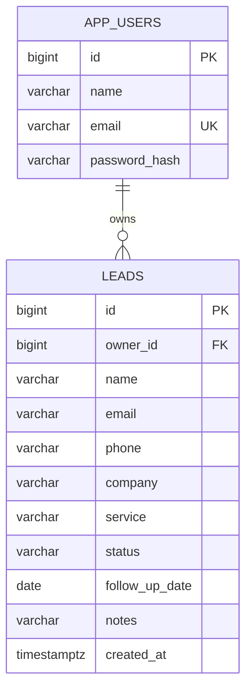

# Architecture and database

## Request flow

1. React collects form values and performs browser validation.
2. `api.js` fetches a CSRF token, attaches it to writes, and sends the session cookie automatically.
3. Spring Security validates the session and CSRF token before a controller runs.
4. Controller validates the request DTO and extracts the authenticated email.
5. LeadService resolves the user's ID and applies ownership rules.
6. LeadRepository uses JPA parameterized queries; PostgreSQL persists the data.
7. The controller returns JSON; React refreshes the table and metrics.

Authentication uses Spring's standard form-login filter. Registration is a normal controller endpoint. BCrypt hashes passwords; plaintext passwords are never persisted. Session IDs are held in HttpOnly cookies, not localStorage. Session fixation protection is provided by the standard Spring Security login flow.

The frontend source is public, as for every browser app. It only renders the dashboard after `/auth/me` succeeds. Security comes from protected backend endpoints and per-user query conditions, not hiding JavaScript files.

## Layers

- **Controller:** HTTP routes, JSON DTO validation, response codes.
- **Service:** application rules and transaction boundaries.
- **Repository:** SQL access through Spring Data JPA.
- **Entity:** Java mapping of a database table.
- **DTO:** approved client input. The client cannot choose ownership or creation time.

Small entities use explicit public fields to keep persistence mapping readable without Lombok or boilerplate getters. Do not put the password hash in response objects; the auth controller returns a dedicated Profile record.

## Schema

Phone numbers are strings to preserve `+`, spacing, and leading zeros. Created timestamps are server-generated UTC instants; follow-up dates are calendar dates. A SQL check constraint and Java enum both limit lead statuses. Separate users can record the same customer email, so lead email is not unique.

The actual source of schema truth is the Flyway migration. Do not edit an applied migration in production; add `V2__description.sql` for later changes.

## Design choices and tradeoffs

- A monolith is easier to run and explain than microservices for this scale.
- Serving React from Spring in production avoids cross-origin cookies and CORS complexity.
- Sessions simplify logout and revocation; JWTs are unnecessary here.
- PostgreSQL supplies durable storage and referential integrity.
- H2 reduces local prerequisites but does not replace a PostgreSQL deployment smoke test.
- Filtering and pagination happen in SQL, not after loading every record in React.
- A donut chart compares stage counts; converted / total is a clear descriptive metric, not a time-based sales forecast.
- The API uses 404 for another user's lead to avoid revealing whether the ID exists.
- React separates page components, reusable dialogs, shared constants, and the API helper into clearly named modules.

## Security follow-ups for real traffic

Use HTTPS, keep secure cookies enabled, limit authentication requests at the reverse proxy, configure backups and retention, add email verification and recovery, and review dependency patches. Do not log passwords. Protect access to server logs, which may contain technical details. Trust forwarded headers only from your hosting reverse proxy. For multiple replicas use a shared session store and add concurrency control to prevent last-write-wins edits.
